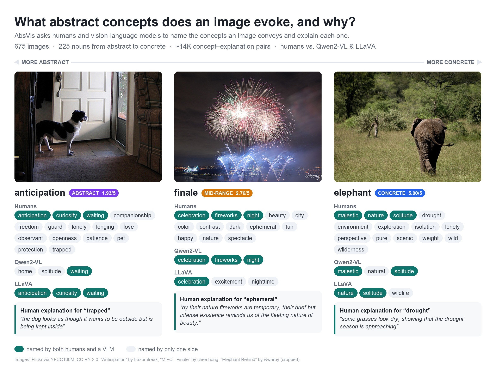
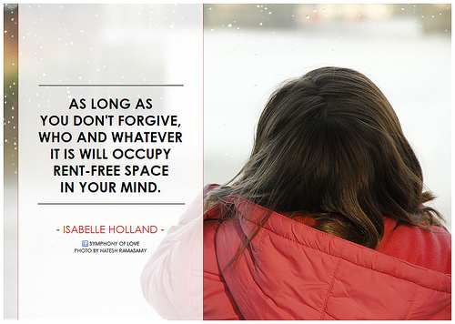
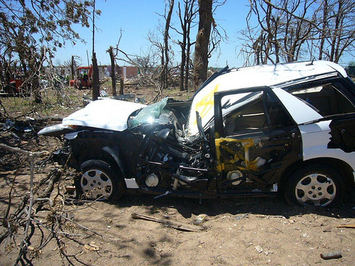
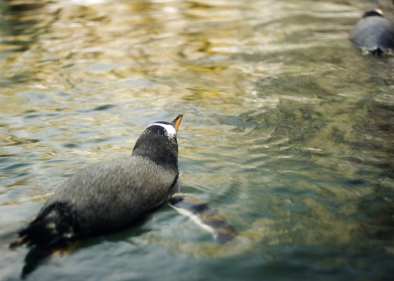

# AbsVis — Benchmarking How Humans and Vision-Language Models “See” Abstract Concepts in Images - EMNLP 2025 Long Paper (Main)

[](https://aclanthology.org/2025.emnlp-main.417/)
[](https://huggingface.co/datasets/Tarun/AbsVis)
[](https://creativecommons.org/licenses/by/4.0/)

<p align="center">
  
</p>

AbsVis is the dataset accompanying the EMNLP 2025 paper  
**"AbsVis — Benchmarking How Humans and Vision-Language Models 'See' Abstract Concepts in Images."**  
It examines how abstract concepts (e.g., *catastrophe, geography, strategy, mercy*) are visually represented in real images and how humans and vision–language models attribute concepts to those images.


🔗 **ACL Anthology:**  
https://aclanthology.org/2025.emnlp-main.417/

🤗 **Hugging Face (with images):**  
https://huggingface.co/datasets/Tarun/AbsVis

The Hugging Face version includes all 675 original images, each with its Creative Commons license and photographer attribution:

```python
from datasets import load_dataset

images = load_dataset("Tarun/AbsVis", "images", split="train")            # 675 images + noun + license/attribution
annotations = load_dataset("Tarun/AbsVis", "annotations", split="train")  # human, Qwen and LLaVA concept–explanation pairs
```

---

## At a Glance

- **675 images** from YFCC100M, 3 per noun, for **225 nouns** spanning the concreteness scale (75 abstract, 75 mid-range, 75 concrete)
- **~14K concept–explanation pairs**: up to 15 per image from humans (220 Prolific participants), plus 3 per image each from **Qwen2-VL-7B-Instruct** and **LLaVA-NeXT** (`llava-v1.6-mistral-7b-hf`)
- Every concept comes with a free-text **explanation** of *why* the image evokes it

**Main findings:** humans attribute more varied concepts than VLMs. Concepts attributed by *both* humans and VLMs are the most preferred, and explanations strengthen the perceived attributions.

## Examples

<table>
<tr>
<th width="33%"><i>forgiveness</i> (abstract)</th>
<th width="33%"><i>catastrophe</i> (mid-range)</th>
<th width="33%"><i>penguin</i> (concrete)</th>
</tr>
<tr>
<td></td>
<td></td>
<td></td>
</tr>
<tr>
<td>
<b>Humans</b> (15): embrace, emotional burden, forgiveness, freedom, open-minded, peaceful, reflection, sadness, tension, wisdom, …<br>
<i>freedom</i>: "the message implies that forgiveness offers emotional freedom"<br><br>
<b>Qwen</b>: forgiveness, mental space, isabelle holland<br>
<b>LLaVA</b>: inspiration, motivation, reflection
</td>
<td>
<b>Humans</b> (15): accident, anxiety, curiosity, damage, fear, pain, recovery, ruin, sadness, warning, …<br>
<i>anxiety</i>: "seeing crashes like this make me apprehensive to get into a car and drive myself"<br><br>
<b>Qwen</b>: accident, damage, nature<br>
<b>LLaVA</b>: abandonment, desolation, destruction
</td>
<td>
<b>Humans</b> (15): beauty of nature, calm, cold, learning, nature, peace, song, summer, waterproof, wildlife, …<br>
<i>peace</i>: "nature is peace for the soul"<br><br>
<b>Qwen</b>: reflection, solitude, tranquility<br>
<b>LLaVA</b>: nature, serenity, solitude
</td>
</tr>
</table>

<sub>Images (unmodified, from YFCC100M/Flickr):
<a href="http://www.flickr.com/photos/85608594@N00/10321368135/">"As long as you don't forgive…"</a> by symphony of love, <a href="https://creativecommons.org/licenses/by/2.0/">CC BY 2.0</a> ·
<a href="http://www.flickr.com/photos/40567541@N08/8815632720/">"Car destroyed by tornado in Granbury, TX"</a> by State Farm, <a href="https://creativecommons.org/licenses/by/2.0/">CC BY 2.0</a> ·
<a href="http://www.flickr.com/photos/91351004@N00/424856940/">"Swimming Penguin"</a> by Nrbelex, <a href="https://creativecommons.org/licenses/by-sa/2.0/">CC BY-SA 2.0</a></sub>

---

## Repository Structure

This repository currently includes:

### `metadata/nouns_list.csv`
This file contains the set of nouns used in the AbsVis dataset.  
Each noun is matched with its concreteness rating and assigned one of three categories based on the rating:

- **abstract**  
- **mid-range**  
- **concrete**

---

### `metadata/image_noun_mapping.csv`
This file lists every **image–noun pair** used in the AbsVis dataset.  
Each row contains a single image name and the noun associated with that image.

**Columns:**
- `image_name`  
- `noun`


---

### `metadata/noun_image_mapping.csv`
This file lists every **noun–image pair**, in the reverse direction of the previous file.  
Each row contains a noun and one of its associated image names.

**Columns:**
- `noun`  
- `image_name`

---

### `metadata/images_list.csv`
This file contains the complete set of **unique image names** used in the AbsVis dataset.  
Each row contains a single image ID.

**Columns:**
- `image_name`

---

### `annotations/` (human & model explanations)

This repository also includes the `annotations/` folder with raw explanations collected from humans and two vision–language models (Qwen, LLaVA). 

Provided annotation CSVs:
- `annotations/annotations_human_raw.csv` — human explanations (one row per human explanation)
- `annotations/annotations_qwen_raw.csv` — Qwen explanations (one row per model output)
- `annotations/annotations_llava_raw.csv` — LLaVA explanations (one row per model output)
- `annotations/annotations_all_raw.csv` — combined, with a `source` column

**Note on human explanation counts (quality control):**  
During annotation quality control we intentionally retained only substantive human explanations. One word responses were excluded from the final CSV in order to keep the dataset focused on meaningful concept–explanation pairs. As a result, a small number of images have fewer than 15 human explanations: 

Distribution of human explanation counts per image:
```
10: 1
13: 7
14: 28
15: 639
```

---


## 📚 Citation

If you use **AbsVis**, please cite:

```bibtex
@inproceedings{tater-etal-2025-absvis,
    title = "{A}bs{V}is {--} Benchmarking How Humans and Vision-Language Models ``See'' Abstract Concepts in Images",
    author = "Tater, Tarun  and
      Frassinelli, Diego  and
      Schulte im Walde, Sabine",
    booktitle = "Proceedings of the 2025 Conference on Empirical Methods in Natural Language Processing",
    month = nov,
    year = "2025",
    address = "Suzhou, China",
    publisher = "Association for Computational Linguistics",
    url = "https://aclanthology.org/2025.emnlp-main.417/",
    doi = "10.18653/v1/2025.emnlp-main.417",
    pages = "8260--8281",
    ISBN = "979-8-89176-332-6",
}
```
